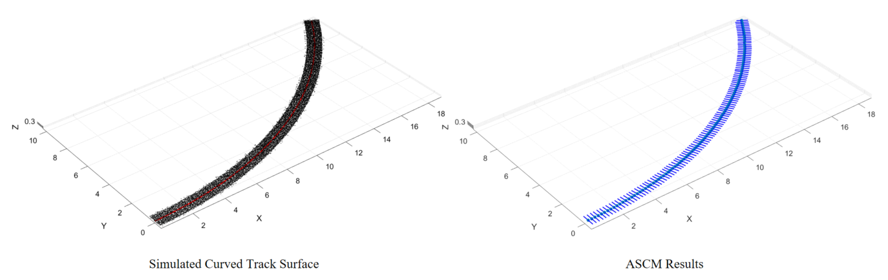

## How to Run

1. Download or clone the repository.
2. Open the folder in MATLAB.
3. Run `main_demo.m`.

## Citation
@ARTICLE{zhou2026uavtrack,
  author={Zhou, Yihan and Hua, Jiahao and Chen, Taicong and Yuan, Zihuan and Ma, Zhenkai and Hu, Qingyuan},
  journal={IEEE Transactions on Instrumentation and Measurement}, 
  title={Low-Altitude UAV-Based 3D Reconstruction for Comprehensive Track Irregularity Detection}, 
  year={2026},
  doi={10.1109/TIM.2026.3747074}
}
